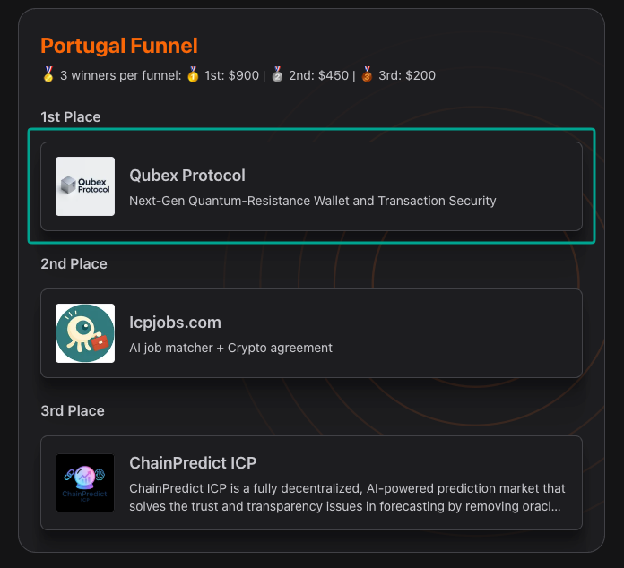

<h1 align="center">Hey  , I'm Thox 🤠 🇫🇷</h1>

<h3 align="center">Passionate about new Technology, Solutions and blockchain   From web applications to decentralized protocols, I enjoy turning ideas into working prototypes</h3>

## Hackathons ☄️

Building with a team or solo, experimenting, and shipping under a deadline.

| Date  | Hackathon  | Project & Idea  |  Prize Won ?  | Result |
| :--- | :--- | :--- | :---: | :--- |
| Sep 4-13, 2026 | **[ETHOnline](https://ethglobal.com/showcase/koven-7598i)** | **[Koven](https://github.com/tetedub/Koven)** - Credit and policy infrastructure for autonomous x402 agents on Hedera | - | - |
| Aug 27 - Sep 17, 2026 | **[Commonsmade](https://commonsmade.com/hackathons)** | **[Intent Arcade](https://spry-lagoon-6e751f.vibe.commonsmade.com)** | - | in progress |
| Feb 9-10, 2026 | [FoxyHack - Air and Space Force](https://event.eventozor.com/FOXYHACK/) | **[TraceOps](https://github.com/tetedub/Trace-Ops)** — decision traceability with Hyperledger Fabric, APIs, and access management | Special jury commendation for the most audacious project | - |
| Jan 30–Feb 1, 2026 | **Aptos x402** | **[x402-inspector](https://github.com/tetedub/x402-inspector)** - an observability SDK for Aptos x402 payment flows | - | - |
| Dec 17–27, 2025 | **CapX** | **[Hivee](https://github.com/tetedub/Hivee)** — a decentralized lending and borrowing protocol for autonomous AI agents | - | Special shoutout |
| Jul–Sep 2025 | **[WCHL](https://dorahacks.io/hackathon/wchl25-qualification-round/detail)** | **[Qubex Protocol](https://github.com/Qubex-Protocol)** - securing transactions against post-quantum attacks | 🥇  | 1st in the Portugal qualifying round · 4th in the second phase · semifinal qualification |
| Jul 11–14, 2025 | **[Chiliz](https://www.chiliz.com/hacking-paris/)** | **[Kolise (Fan token project)](https://github.com/tetedub/Kolise)** — a sports engagement app with fan tokens, NFTs, and 3D avatars | - | - |
| Oct 4-6, 2024 | **[Vierzon . B3 Village by CA](https://www.sia-partners.com/fr/publications/publications-de-nos-experts/hackathon-blockchain-vierzon)** | **[Invoice project](https://github.com/tetedub/Invoice-CACIB-web3)** — NFT invoices and interbank payments on the so\|cash protocol | 🥈 3000$ | 2nd place in the CACIB / so\|cash track |

---

---

**Got an idea, a hackathon, or a project to build together?**

[Email me](mailto:digixit66@gmail.com) · [LinkedIn](https://www.linkedin.com/in/th%C3%A9o-dubois-662407194/)

